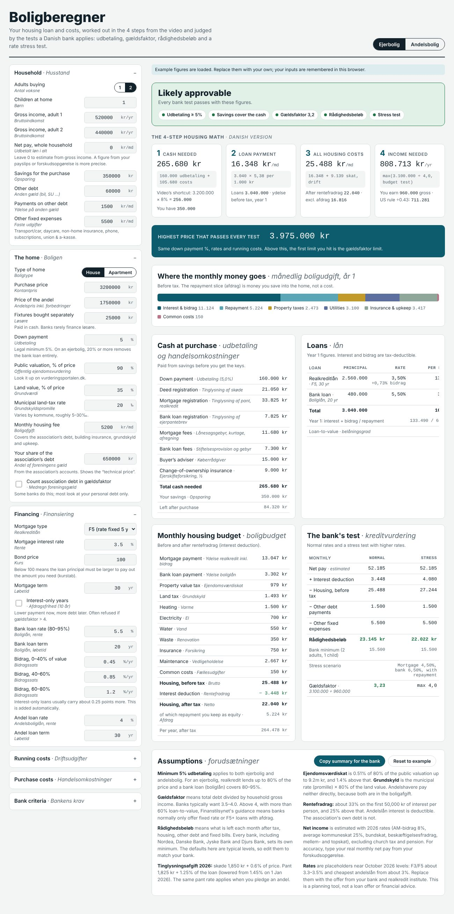
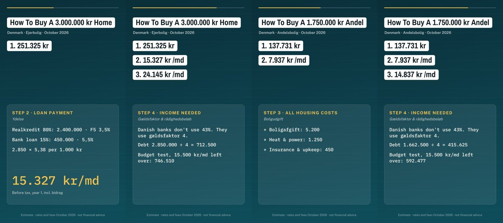

# Boligberegner

Boligberegner calculates what it costs to buy a home in Denmark, for both **ejerbolig** (house or owner apartment) and **andelsbolig** (cooperative housing). It works the way Danish banks assess a home loan, as closely as a public tool can.

This first version covers Denmark only. The plan is to add more countries later.

**Version 1.1.1.** See [CHANGELOG.md](CHANGELOG.md) for what changed in each version. The version is also shown at the bottom of each page.



## What it does

The calculator works in 4 steps:

1. **Cash needed**: the 5% minimum udbetaling plus every handelsomkostning (tinglysning, loan fees, adviser, change-of-ownership insurance).
2. **Loan payment**: realkredit (up to 80%) plus a bank loan for an ejerbolig, or an andelsboliglån for an andelsbolig. It includes bidragssats and kurs.
3. **All housing costs**: ejendomsværdiskat and grundskyld, or boligafgift, plus heating, electricity, water, insurance and maintenance. It shows the cost before and after rentefradrag.
4. **Income needed**: gældsfaktor (debt ÷ gross income), rådighedsbeløb (money left each month) and a stress test with higher rates.

It then finds the highest price that passes every test.

The **Housing Math Reel** (`reel/`) shows the same 4 steps as a 36-second vertical animation. You can type any price and switch between ejerbolig and andelsbolig.



## Files

| Path | What it is |
| --- | --- |
| `index.html` | The calculator. |
| `reel/index.html` | The interactive reel. |
| `assets/` | Styles and scripts for the calculator, and the font definitions. |
| `icon.svg`, `icon-*.png`, `manifest.webmanifest` | App icon and home-screen settings. |
| `fonts/` | Self-hosted fonts and their licence (`fonts/OFL.txt`). |
| `reel/render.js` | Turns the reel into a 1080×1920 MP4 on your own computer. |
| `examples/` | Screenshots. |

## Use it

Open the live site at https://banabhai.github.io/Boligberegner/ (once GitHub Pages is turned on), or open `index.html` in a browser. Nothing to install and no account needed.

**On your phone:** open the site, then add it to your home screen. On iPhone, tap Share, then **Add to Home Screen**. On Android, tap ⋮, then **Add to Home screen**. It opens full screen with its own icon. It still needs an internet connection.

To render the reel as an MP4, you need [Node.js](https://nodejs.org) 18 or newer and [ffmpeg](https://ffmpeg.org):

```bash
cd reel
npm ci
npx playwright install chromium
node render.js ejer 3000000 my-reel.mp4      # ejerbolig, price in kr
node render.js andel 1750000 my-andel.mp4    # andelsbolig, andel price in kr
```

Video files are not stored in this repository.

## Assumptions (October 2026)

You can change every value in the calculator.

- **Tinglysningsafgift:** skøde 1,850 kr + 0.6% of the price. Pant 1,825 kr + 1.25% of the loan (from 1 January 2026).
- **Ejendomsværdiskat:** 0.51% of 80% of the public valuation up to 9.2m kr, then 1.4%. **Grundskyld:** the municipal promille × 80% of the land value.
- **Rentefradrag:** about 33% on the first 50,000 kr of interest per person, and 25% above that.
- **Net income estimate:** AM-bidrag 8%, average kommuneskat 25%, bundskat, beskæftigelsesfradrag, mellemskat and topskat. Church tax and pension are not included.
- **Bank criteria:** gældsfaktor max 4.0, rådighedsbeløb 6,500 kr per adult and 2,500 kr per child, and a stress test with rates 1 point higher. Each bank sets its own limits.
- **Interest rates:** F5 realkredit 3.5%, bank loan 5.5%, andelslån 4.0%. These are examples only. Use the rates from your own loan offer.

Sources: [Skattestyrelsen](https://skat.dk/erhverv/afgifter-paa-varer-og-ydelser-punktafgifter/nyhedsbrev-afgifter/tinglysningsafgift-ny-afgiftssats-pr-1-januar-2026), [Ældre Sagen](https://www.aeldresagen.dk/viden-og-raadgivning/vaerd-at-vide/b/bolig/ejendomsskat/ejendomsvaerdiskat), [Themis beløbsgrænser 2026](https://themis.dk/synopsis/docs/Oversigt_over_beloebsgraenser_2026_.html), [Totalkredit renteudsigt](https://www.totalkredit.dk/boliglan/renteudsigt/).

## Terms of use

Last updated: 26 November 2026. These terms apply to Boligberegner and the Housing Math Reel ("the tool"), published by the owner of this repository ("we"). By using the tool you accept these terms.

1. **Information only, not advice.** The tool gives general estimates for planning. It is not financial, credit, tax, legal or investment advice, and it is not a loan offer or a credit assessment. We are not a bank, a mortgage credit institution or a financial adviser, and we are not authorised or supervised by Finanstilsynet. Before you buy a home or take a loan, get advice from your bank, your realkredit institution and an independent buyer's adviser (køberrådgiver).
2. **No guarantee.** Rates, fees, tax rules and bank criteria change, and each bank applies its own rules. The results can be wrong or out of date. A bank can refuse a loan even when the tool says "likely approvable".
3. **No affiliation.** Bank and company names (for example Nordea, Danske Bank, Jyske Bank, Djurs Bank and Totalkredit) are used only to describe the Danish market. They are trademarks of their owners. We are not connected with them, and they have not approved this tool.
4. **Free and "as is".** The tool is free. It is provided "as is" and "as available", without any warranty that it is complete, accurate, available or free of errors.
5. **Liability.** To the extent the law allows, we are not liable for any loss or damage that comes from using the tool or relying on its results, including decisions to buy, sell or borrow. Nothing in these terms limits liability that the law does not allow us to limit, or your mandatory rights as a consumer.
6. **Acceptable use.** Do not use the tool for anything unlawful. Do not try to attack, overload or misuse the site or the repository.
7. **Intellectual property.** The tool's code, text and design belong to the owner. See [LICENSE](LICENSE). Third-party material keeps its own licence.
8. **Changes.** We may change the tool and these terms. The version number and the date above show when they last changed. Changes are listed in [CHANGELOG.md](CHANGELOG.md).
9. **Law and disputes.** Danish law governs these terms, and disputes go to the Danish courts. If you are a consumer living in another country, you keep the protection that the mandatory law of that country gives you.

## Privacy notice

Last updated: 26 November 2026.

**In short: the tool collects no personal data. Everything you type stays on your own device.**

- **No collection.** The tool has no server, database, user accounts, analytics, advertising, tracking pixels or social media plugins. The calculations run in your browser, and the numbers you enter (for example income, savings and debt) are never sent to us or to anyone else.
- **No third-party requests.** Fonts and all other files are served from this site. The pages do not load anything from Google Fonts, CDNs or other services. A Content Security Policy blocks connections to any other site.
- **Storage on your device.** By default, nothing is stored on your device. If you tick **Remember my inputs on this device**, your inputs are saved in your browser's local storage, so they are still there next time. They never leave your device. Untick the box to delete them, or clear your browser's site data. The reel stores nothing. The tool sets no cookies.
- **Copy summary.** The "Copy summary for the bank" button only copies text to your clipboard. You decide where to paste it.
- **Hosting.** The site is hosted on GitHub Pages. GitHub, Inc. may log technical data such as your IP address when your browser requests the pages, for example for security. We cannot see or control these logs. See the [GitHub General Privacy Statement](https://docs.github.com/en/site-policy/privacy-policies/github-general-privacy-statement).
- **Your rights.** Because we do not receive or store any personal data about you, we have nothing to give you access to, correct or delete. Your saved inputs are under your own control, as described above. If you have questions, open an issue in this repository. Do not include personal or financial details in an issue, because issues are public.
- **Complaints.** You can always complain to a data protection authority. In Denmark this is [Datatilsynet](https://www.datatilsynet.dk).

**Rules this is designed around.** This notice is written with these rules in mind: the EU General Data Protection Regulation (GDPR) and the Danish Data Protection Act (databeskyttelsesloven); the ePrivacy rules on storing information on a device, which in Denmark are in the cookie order (cookiebekendtgørelsen); and comparable laws elsewhere, such as the UK GDPR, the Swiss FADP and the California CCPA/CPRA. Because the tool collects no personal data, sells or shares nothing, and stores data on your device only when you ask it to, these laws place few duties on it. If a future version starts to collect data, this notice will be updated first.

## Security

The tool is a static site with no server code, no database, no logins and no secrets. That leaves very little to attack. In addition:

- A strict Content Security Policy allows only this site's own scripts, styles and fonts, and blocks connections to any other site. Pages send no referrer.
- Saved inputs are checked when they are loaded. Unknown keys, wrong types and out-of-range numbers are thrown away, so changed local storage cannot inject code.
- The page shows only numbers and fixed text. It never inserts text you typed as HTML.
- The MP4 renderer pins its one dependency (Playwright) with a lockfile. Dependabot watches it for security updates.

No software can be guaranteed impossible to hack. To report a security problem, see [SECURITY.md](SECURITY.md).

## Licence

All rights reserved. See [LICENSE](LICENSE). Third-party material keeps its own licence, listed below.

## Credits

- Fonts: [Archivo](https://github.com/Omnibus-Type/Archivo), [Archivo Narrow](https://github.com/Omnibus-Type/ArchivoNarrow), [Public Sans](https://github.com/uswds/public-sans) and [IBM Plex Mono](https://github.com/IBM/plex), under the SIL Open Font License 1.1, via [Fontsource](https://fontsource.org). See [fonts/OFL.txt](fonts/OFL.txt).
- Rates, fees and tax rules: the public sources listed under Assumptions.
